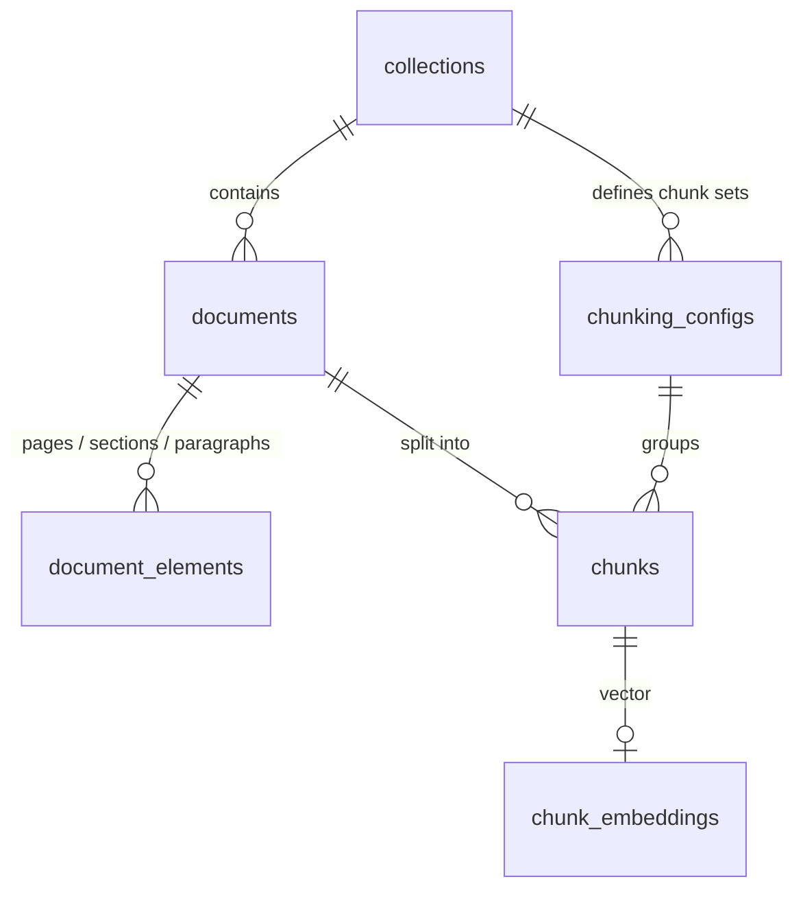

# Adapters — `rag_lab.adapters` and `rag_lab.ui`

Adapters are the only code that touches files, databases, HTTP and frameworks. **Outbound** adapters implement ports used by the application. **Inbound** adapters receive requests and call use cases.

> Other languages: [Português](../pt-BR/adapters.md)

| Adapter | Direction | Implements / calls | Technology |
|---------|-----------|--------------------|------------|
| Parsers | Outbound | `DocumentParser` | pypdf, regex-based Markdown |
| PostgreSQL persistence | Outbound | `UnitOfWork` + repositories | SQLAlchemy Core 2, psycopg 3, Alembic |
| In-memory persistence | Outbound | `UnitOfWork` + repositories | Plain dicts |
| Chat model | Outbound | `ChatModel` | LangChain `ChatOpenAI` → any OpenAI-compatible `/chat/completions` API |
| Reranking | Outbound | `Reranker` | Sentence Transformers cross-encoder, or `httpx` → any `/rerank` API |
| Embeddings | Outbound | `Embedder` | LangChain `OpenAIEmbeddings` → any OpenAI-compatible API |
| HTTP API | Inbound | `IngestionService` | FastAPI, Pydantic v2 |
| Streamlit UI | Inbound (client) | HTTP API | Streamlit, httpx |

---

## Parsers — `adapters/outbound/parsers/`

| Module | What it produces |
|--------|------------------|
| `registry.py` | `ParserRegistry`: picks the parser by extension; rejects empty files, unknown types and `.pdf` files without the `%PDF-` signature |
| `text.py` | Decodes UTF-8 (BOM tolerated), falls back to Latin-1; paragraphs become `PARAGRAPH` elements |
| `markdown.py` | ATX headings (`#`…`######`) become `SECTION` elements with breadcrumb paths. Headings inside fenced code blocks are ignored. YAML-style front matter (`key: value`) feeds metadata. Title = front matter → first H1 → filename |
| `pdf.py` | One `PAGE` element per page with text; pages are joined with a blank line. Blank pages are skipped **but numbering is kept**, so citations show the real page. PDF title/author go to metadata |
| `normalize.py` | Shared normalisation: `\r\n`/`\r` → `\n`, NUL removed (PostgreSQL text cannot store it) |

**Why pypdf and not PyMuPDF?** PyMuPDF extracts layout better but is licensed AGPL-3.0, which is a problem for anyone reusing this code. pypdf is BSD, pure Python and good enough for text-layer PDFs. The parser sits behind a port, so swapping it later is one class. **OCR is out of scope:** a scanned PDF fails with an explicit message instead of being silently indexed as empty.

**Why regex for Markdown instead of a full Markdown parser?** Only headings, code fences and front matter are needed, and the offsets must be exact against the *raw* text. A full CommonMark AST would add a dependency and a mapping step back to offsets for no gain.

## Embeddings — `adapters/outbound/embeddings/`

`OpenAICompatibleEmbedder` calls `POST {EMBEDDING_BASE_URL}/embeddings` through LangChain's `OpenAIEmbeddings`. It works with OpenAI, OpenRouter, Ollama, llama.cpp, vLLM and others.

| Setting | Value | Why |
|---------|-------|-----|
| `check_embedding_ctx_length` | `False` | LangChain's default tokenizes with tiktoken and sends **token ids**, which only OpenAI accepts. Raw text works with every provider |
| `dimensions` | never sent | Most providers cannot shorten vectors and some reject the field; `EMBEDDING_DIMENSIONS` validates the response instead |
| `chunk_size` | `EMBEDDING_BATCH_SIZE` | Texts per HTTP request |
| `max_retries` / `request_timeout` | `2` / `LLM_TIMEOUT_SECONDS` | Transient errors are retried by the OpenAI SDK |
| Empty API key | replaced by a placeholder | The SDK refuses empty keys; local servers ignore the value |

Every `openai.OpenAIError` (HTTP error, timeout, connection refused) becomes `EmbeddingProviderError`, with the URL and model in the message → HTTP 502.

**Why LangChain here and not the raw `openai` SDK?** The project stack names LangChain, and its value is at the provider edge: one interface (`Embeddings`) over many providers, which later phases reuse for chat models. It stays inside this adapter; the rest of the code only sees the `Embedder` port.

## Chat model — `adapters/outbound/generation/`

`OpenAICompatibleChatModel` calls `POST {LLM_BASE_URL}/chat/completions` through LangChain's `ChatOpenAI`.

| Parameter | Value | Why |
|-----------|-------|-----|
| `use_responses_api` | `False` | The OpenAI Responses API exists only at OpenAI; Chat Completions is what every compatible server implements |
| `temperature` / `reasoning_effort` | only when set in `.env` | Reasoning models reject `temperature` (see [configuration](configuration.md#temperature-vs-reasoning-effort)); nothing is sent by default |
| `max_retries` / `timeout` | `2` / `LLM_TIMEOUT_SECONDS` | Transient errors are retried by the SDK |
| empty API key | replaced by a placeholder | The SDK refuses empty keys; local servers ignore the value |

Every `openai.OpenAIError` becomes `GenerationProviderError` with the model and URL (not the upstream body) → HTTP 502. Token usage comes from the response `usage` when the provider sends it.

## Reranking — `adapters/outbound/reranking/`

| Adapter | `RERANKER_PROVIDER` | How it works |
|---------|---------------------|--------------|
| `CrossEncoderReranker` | `local` (default) | Sentence Transformers `CrossEncoder` in the API process. The model (`RERANKER_MODEL`, default `cross-encoder/ms-marco-MiniLM-L-6-v2`, ~90 MB) is downloaded and loaded on the **first** reranked search, behind a lock so concurrent requests load it once |
| `HttpReranker` | `api` | `POST {RERANKER_BASE_URL}/rerank` with `{model, query, documents, top_n}` and `Authorization: Bearer RERANKER_API_KEY`. Reads `{"results": [{"index", "relevance_score"}]}` (Jina, Cohere v2, llama.cpp server, vLLM) or a bare `[{"index", "score"}]` list, and maps scores back to input order by `index` |

- `sentence-transformers` and torch are an **optional extra** (`uv sync --extra local-rerank`). On Linux, torch comes from the PyTorch CPU index (`[tool.uv.sources]`), which avoids gigabytes of CUDA libraries. Without the extra, a reranked search returns 502 with "Install the 'local-rerank' extra or set RERANKER_PROVIDER=api".
- The first reranked search pays the model load (seconds). Latency benchmarks warm the reranker up before measuring.
- Every failure (load, runtime, HTTP status, malformed body, unreachable host) becomes `RerankerError` → HTTP 502.

**Why not rerank through LangChain?** LangChain's rerankers wrap specific vendors; a 40-line `httpx` adapter covers every `/rerank` server that speaks the de facto Jina/Cohere schema, and the local adapter is a thin wrapper over the library that actually runs the model.

## Persistence — `adapters/outbound/persistence/`

### PostgreSQL (`postgres/`)

| File | Role |
|------|------|
| `tables.py` | SQLAlchemy Core table definitions (the schema) |
| `repositories.py` | Repository implementations; unique-constraint violations become `ConflictError` |
| `unit_of_work.py` | One connection + one transaction per `with` block |
| `migrations/versions/0001_reference_layer.py` | Alembic migration creating the reference-layer schema |
| `migrations/versions/0002_embeddings.py` | Enables `vector`, adds the collection binding columns and `chunk_embeddings` |
| `migrations/versions/0003_retrieval.py` | Adds `collections.fulltext_language` and `chunks.search_vector` (backfilled, GIN index) |

Schema highlights:

- `UNIQUE (collection_id, content_hash)` on `documents` makes deduplication safe even under concurrent uploads.
- `chunks` has a composite FK `(collection_id, config_key) → chunking_configs`: a chunk cannot exist in an undeclared chunk set.
- `CHECK (start_offset >= 0 AND end_offset > start_offset)` mirrors the `Span` invariant in the database.
- Deleting a collection cascades to everything it owns.
- `alembic check` confirms the migration matches `tables.py` (no drift).
- `collections.embedding_model` / `embedding_dimensions` store the binding, with a CHECK that both are NULL or both set.
- `chunk_embeddings(chunk_id → chunks.id ON DELETE CASCADE, collection_id, config_key, model, dimensions, embedding vector)`. The `embedding` column has **no fixed dimension**, because collections may use different models. `CHECK (vector_dims(embedding) = dimensions)` keeps each row honest. Re-chunking a document deletes its chunks, and their vectors go with them. See [ADR-012](decisions.md#adr-012-one-vector-table-without-a-fixed-dimension).
- Migration 0002 runs `CREATE EXTENSION IF NOT EXISTS vector`, which needs a role allowed to create extensions (the Compose database owner is).
- `collections.fulltext_language` and `chunks.search_vector` (migration 0003) support full-text search.

### Search (`PostgresSearchRepository`)

| Method | SQL | Score |
|--------|-----|-------|
| Vector | `embedding <=> :query` over `chunk_embeddings` of the chunk set, ordered by distance | `1 - cosine distance` (cosine similarity) |
| Full-text | `search_vector @@ :tsquery`, ordered by `ts_rank_cd(search_vector, tsquery, 1)` | Cover density, divided by `1 + log(length)` |

- **Exact vector search, no ANN index.** Every query scans the vectors of one chunk set. Benchmark numbers then measure the retrieval *strategy*, not the recall lost by an approximate index. See [ADR-014](decisions.md#adr-014-exact-vector-search-for-the-benchmark).
- **`search_vector`** is `to_tsvector(<collection language>, text)`, computed by the repository when chunks are inserted and indexed with **GIN**. Migration 0003 backfills it for existing chunks.
- **OR queries.** `plainto_tsquery` joins words with AND, which rejects most chunks for a natural-language question. The repository keeps its normalisation (stemming, stop words) and rewrites `&` as `|`, so a chunk matches when it shares **any** term, and chunks sharing more terms rank higher. See [ADR-013](decisions.md#adr-013-postgresql-full-text-as-the-lexical-baseline).
- Ties are broken by reading order (document, then chunk index), so results are deterministic.

**Why SQLAlchemy Core and not the ORM?** Domain entities are frozen dataclasses. ORM mapping would need mutable, instrumented classes or a second set of models. Core gives explicit SQL with typed tables, and the mapping functions are short and visible. **Why not raw SQL strings?** Core composes queries safely (no string concatenation) and generates the Alembic baseline. **Why PostgreSQL?** pgvector (phase 2) and native full-text search (phase 3) let vector, lexical and hybrid retrieval run in **one** database, so latency comparisons are fair.

### In-memory (`memory.py`)

The same contract backed by dictionaries, with real rollback (each transaction works on a copy until `commit`). It powers fast unit tests and API tests. The **same contract tests** run against both adapters, so the in-memory store cannot drift from PostgreSQL behaviour.

## HTTP API — `adapters/inbound/api/`

| Method | Path | Purpose |
|--------|------|---------|
| `GET` | `/health` | Liveness |
| `POST` | `/collections` | Create a collection; without `chunking_configs`, one per strategy using the `.env` defaults |
| `GET` | `/collections` · `/collections/{id}` | List / get |
| `POST` | `/collections/{id}/chunking-configs` | Add a chunk set and chunk existing documents |
| `POST` | `/collections/{id}/documents` | Upload one file (`multipart/form-data`, field `file`) |
| `GET` | `/collections/{id}/documents` | Document summaries |
| `GET` | `/collections/{id}/documents/{doc}` | Canonical text, structure, metadata |
| `GET` | `/collections/{id}/chunk-sets/{key}/chunks?document_id=` | Chunks with spans, pages and heading paths |
| `POST` | `/collections/{id}/chunk-sets/{key}/index?rebuild=false` | Embed pending chunks; returns total / already indexed / embedded / seconds |
| `GET` | `/collections/{id}/index` | Embedding binding and `embedded / total` per chunk set |
| `POST` | `/collections/{id}/answer` | Body `{question, chunk_set, method, top_k, document_ids}`; returns the answer, `abstained` + `abstention_reason`, `citations` (number → source), `citations_valid`, `invalid_citations`, every `source`, model, token usage and timings |
| `POST` | `/collections/{id}/search` | Body `{query, chunk_set, method: vector\|fulltext\|hybrid\|hybrid_rerank, top_k, document_ids}`; returns ranked hits with spans, score, `ranks` per stage and timings |

Interactive docs are served at `http://localhost:8000/docs` (OpenAPI).

- `app.py` holds the factory `create_app(container=None)` and the mapping from application errors to HTTP status codes. Without a container it wires PostgreSQL; tests inject the in-memory one.
- `schemas.py` holds the Pydantic request/response models. They are kept separate from domain types, so the HTTP contract can evolve without changing the core.
- The upload route reads **at most `MAX_UPLOAD_MB` + 1 byte**, so oversized files are rejected without being buffered whole.

**Why FastAPI?** Typed request validation, automatic OpenAPI docs and dependency injection, at very low ceremony.

## Composition root — `bootstrap.py`

`build_container(settings)` wires PostgreSQL. `build_in_memory_container(settings)` wires the in-memory store. This is the **only** module that knows concrete adapters, so changing an implementation is a one-line change here.

## Streamlit UI — `rag_lab/ui/`

| Module | Role |
|--------|------|
| `app.py` | Entry point and navigation |
| `pages/home.py` | Overview of both pipelines |
| `pages/ingestion.py` | Collections (sidebar), uploads, document list, **chunk inspector**, indexing progress and the **Index chunk set** action (with optional rebuild) |
| `pages/ask.py` | **Grounded answers** in three panels: scope and strategy (sidebar), the answer with citation badges (unknown sources flagged) and the abstention reason, and every source with the cited ones marked |
| `pages/retrieval.py` | **Method comparison**: one question, four columns (vector, full-text, hybrid, hybrid + rerank; a toggle skips reranking), each hit with score, rank per stage (including its hybrid rank before reranking), location and highlighted query terms; document filter and `top_k` in the sidebar |
| `highlight.py` | Pure functions rendering chunk spans as alternating highlights (overlaps get their own colour) and marking query terms as evidence |
| `api_client.py` | Typed `httpx` client for the API |
| `theme.py` + `.streamlit/config.toml` | Visual identity: white canvas, blue accent `#2563EB`, Inter font, cards and badges |

The chunk inspector puts the same document under different chunk sets side by side. You can *see* why `fixed` cuts sentences while `structure` follows headings, which is the visual answer to "why does chunking affect retrieval?".

**Why does the UI call the API instead of importing services?** It keeps the UI a replaceable client (a React front end could use the same API) and makes the API the single tested entry point. **Why Streamlit?** It builds data-heavy dashboards quickly in the same language as the rest of the project. Custom CSS brings it close to the reference design. See [ADR-007](decisions.md#adr-007-streamlit-with-custom-css).
