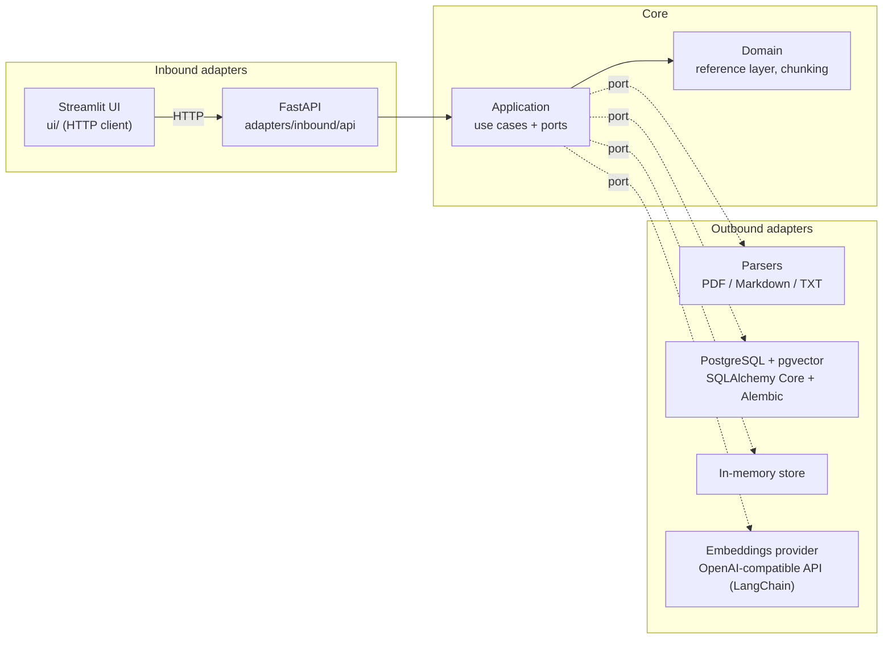
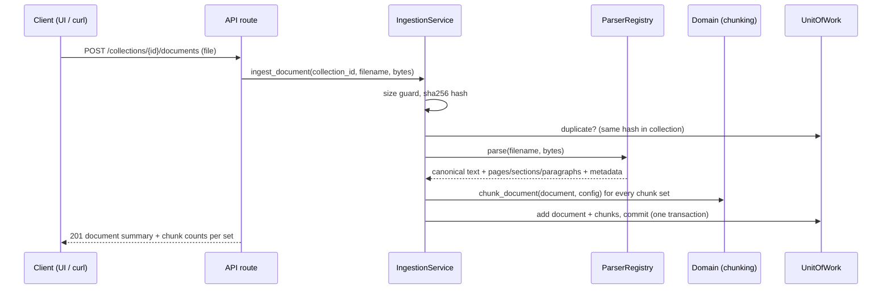
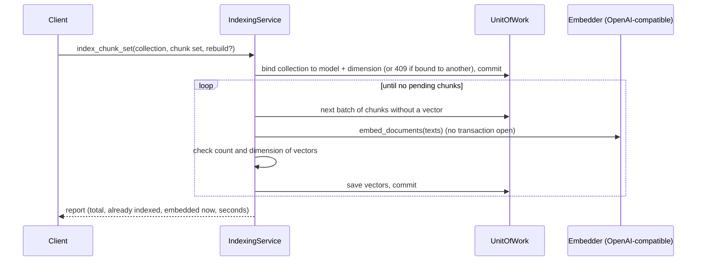
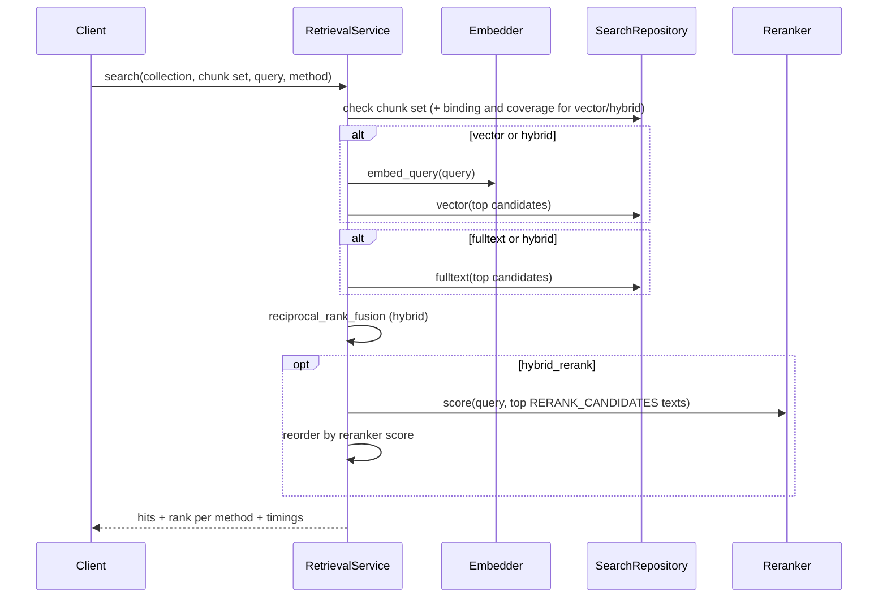
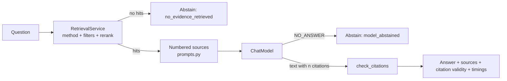

# Architecture

RAG Benchmark Lab uses a **hexagonal architecture** (ports and adapters). Business rules live in a pure core. Frameworks, databases and model providers plug in from the outside. Retrieval strategies, LLM providers and storage can therefore be swapped and compared without touching the rules being measured.

> Other languages: [Português](../pt-BR/architecture.md)

## The layers at a glance



| Layer | Package | Purpose | May import |
|-------|---------|---------|------------|
| Domain | `rag_lab.domain` | Business concepts and pure algorithms (spans, documents, chunking) | Standard library only |
| Application | `rag_lab.application` | Use cases, and the ports (interfaces) they need | Domain |
| Adapters | `rag_lab.adapters` | Implement ports (outbound) or call use cases (inbound) | Application, domain, frameworks |
| Composition root | `rag_lab.bootstrap` | Decides which adapter implements which port | Everything |
| UI | `rag_lab.ui` | Streamlit pages; talks to the system **only through the HTTP API** | `config`, its own modules |

**The dependency rule:** arrows only point inwards. The domain never imports FastAPI, SQLAlchemy, pypdf or LangChain. The type checker (`mypy --strict`) and the test suite run on every commit, so a violation shows up immediately.

## Data flows

### Ingestion (implemented)



### Indexing (implemented)



Each batch is committed on its own, so a provider failure halfway loses nothing: the next run embeds only what is still pending.

### Retrieval (implemented)



### Question answering (implemented)



### Evaluation (implemented)

```mermaid
flowchart LR
    D[Documents] -->|seeded passages| G[LLM drafts]
    M[Manual question + excerpt] --> R
    G --> R[Human review<br/>approve / reject / edit]
    R -->|approved| B[BenchmarkService]
    B -->|chunk sets x methods| S[Recall@k, MRR, latency, CPU]
    B -->|optional| A[Answers: citations, abstention, judge]
    S --> P[Run stored + Markdown/JSON report]
    A --> P
```

## The reference layer: why chunking can vary freely

This is the most important design decision in the project. See [ADR-002](decisions.md#adr-002-a-chunking-independent-reference-layer).

- Each document is parsed **once** into a **canonical text**.
- Pages, sections and paragraphs are stored as **spans** (`[start, end)` character offsets) over that text.
- A **chunk** is just a span plus derived metadata (page numbers, heading path).
- Golden-dataset labels (phase 6) will also be spans over the same text.

```text
canonical text:  |# Install\nRun it.\n\n## Docker\ndocker compose up\n|
sections:        [0 ─────────── 19)[19 ───────────────────────── 47)
fixed-20-0:      [0 ──── 20)[20 ──── 40)[40 ─ 47)
structure-800-0: [0 ─────── 17)  [19 ────────────────────── 46)
golden label:                          [29 ──────────── 46)
```

Relevance is measured by **overlap between spans**, not by matching chunk ids. A label written once stays valid for every chunking configuration, and that is what makes a chunking × retrieval benchmark matrix possible.

## Isolation

The **collection** is the isolation boundary. Every repository method that returns documents or chunks takes a `collection_id`, so the port's signature itself enforces the scope. The contract tests in `tests/contracts/test_isolation.py` run against both the in-memory and the PostgreSQL adapters. They prove that identical documents in two collections stay separate, and that a document id from another collection returns *not found*.

## Where to go next

| I want to understand… | Read |
|-----------------------|------|
| Spans, documents, chunking algorithms | [domain.md](domain.md) |
| Use cases, ports, transactions | [application.md](application.md) |
| Parsers, PostgreSQL, API, UI | [adapters.md](adapters.md) |
| `.env` settings and providers | [configuration.md](configuration.md) |
| Test strategy and how to run tests | [testing.md](testing.md) |
| Why each technology was chosen | [decisions.md](decisions.md) |
