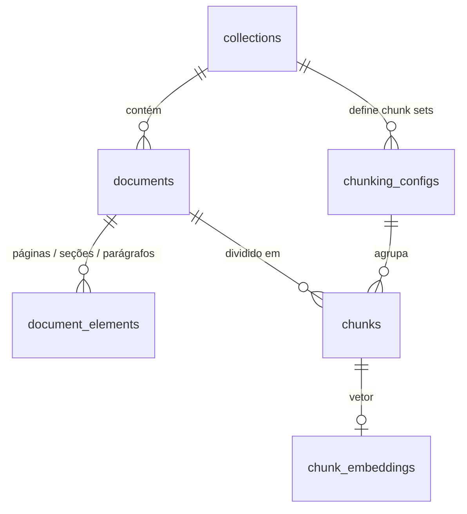

# Adaptadores — `rag_lab.adapters` e `rag_lab.ui`

Os adaptadores são o único código que toca arquivos, bancos de dados, HTTP e frameworks. Os adaptadores de **saída** implementam ports usados pela aplicação. Os de **entrada** recebem requisições e chamam casos de uso.

> Outros idiomas: [English](../en/adapters.md)

| Adaptador | Direção | Implementa / chama | Tecnologia |
|-----------|---------|--------------------|------------|
| Parsers | Saída | `DocumentParser` | pypdf, Markdown via regex |
| Persistência PostgreSQL | Saída | `UnitOfWork` + repositórios | SQLAlchemy Core 2, psycopg 3, Alembic |
| Persistência em memória | Saída | `UnitOfWork` + repositórios | Dicionários simples |
| Embeddings | Saída | `Embedder` | `OpenAIEmbeddings` do LangChain → qualquer API compatível com OpenAI |
| API HTTP | Entrada | `IngestionService` | FastAPI, Pydantic v2 |
| UI Streamlit | Entrada (cliente) | API HTTP | Streamlit, httpx |

---

## Parsers — `adapters/outbound/parsers/`

| Módulo | O que produz |
|--------|--------------|
| `registry.py` | `ParserRegistry`: escolhe o parser pela extensão; rejeita arquivos vazios, tipos desconhecidos e `.pdf` sem a assinatura `%PDF-` |
| `text.py` | Decodifica UTF-8 (tolera BOM) e usa Latin-1 como alternativa; parágrafos viram elementos `PARAGRAPH` |
| `markdown.py` | Títulos ATX (`#`…`######`) viram elementos `SECTION` com caminhos de títulos. Títulos dentro de blocos de código são ignorados. Front matter no estilo YAML (`chave: valor`) alimenta os metadados. Título = front matter → primeiro H1 → nome do arquivo |
| `pdf.py` | Um elemento `PAGE` por página com texto; as páginas são unidas por uma linha em branco. Páginas em branco são puladas **mas a numeração é mantida**, então as citações mostram a página real. Título e autor do PDF vão para os metadados |
| `normalize.py` | Normalização compartilhada: `\r\n`/`\r` → `\n`, remoção de NUL (o PostgreSQL não armazena esse caractere em texto) |

**Por que pypdf e não PyMuPDF?** O PyMuPDF extrai o layout melhor, mas tem licença AGPL-3.0, o que é um problema para quem quiser reutilizar este código. O pypdf é BSD, Python puro e suficiente para PDFs com camada de texto. O parser fica atrás de um port, então trocá-lo depois é uma classe. **OCR está fora do escopo:** um PDF escaneado falha com uma mensagem explícita em vez de ser indexado vazio em silêncio.

**Por que regex para Markdown em vez de um parser Markdown completo?** Só são necessários títulos, blocos de código e front matter, e os offsets precisam ser exatos sobre o texto *bruto*. Uma AST CommonMark completa traria uma dependência e um passo extra de mapeamento de volta aos offsets, sem ganho.

## Embeddings — `adapters/outbound/embeddings/`

`OpenAICompatibleEmbedder` chama `POST {EMBEDDING_BASE_URL}/embeddings` pelo `OpenAIEmbeddings` do LangChain. Funciona com OpenAI, OpenRouter, Ollama, llama.cpp, vLLM e outros.

| Parâmetro | Valor | Por quê |
|-----------|-------|---------|
| `check_embedding_ctx_length` | `False` | O padrão do LangChain tokeniza com o tiktoken e envia **ids de tokens**, que só a OpenAI aceita. Texto puro funciona com qualquer provedor |
| `dimensions` | nunca enviado | A maioria dos provedores não reduz vetores e alguns rejeitam o campo; `EMBEDDING_DIMENSIONS` valida a resposta |
| `chunk_size` | `EMBEDDING_BATCH_SIZE` | Textos por requisição HTTP |
| `max_retries` / `request_timeout` | `2` / `LLM_TIMEOUT_SECONDS` | Erros transitórios são repetidos pelo SDK da OpenAI |
| API key vazia | trocada por um placeholder | O SDK recusa chaves vazias; servidores locais ignoram o valor |

Todo `openai.OpenAIError` (erro HTTP, timeout, conexão recusada) vira `EmbeddingProviderError`, com a URL e o modelo na mensagem → HTTP 502.

**Por que LangChain aqui e não o SDK `openai` direto?** A stack do projeto inclui o LangChain, e o valor dele está na borda dos provedores: uma interface (`Embeddings`) sobre muitos provedores, que as próximas fases reutilizam para os modelos de chat. Ele fica restrito a este adaptador; o resto do código só enxerga o port `Embedder`.

## Persistência — `adapters/outbound/persistence/`

### PostgreSQL (`postgres/`)

| Arquivo | Papel |
|---------|-------|
| `tables.py` | Definições das tabelas com SQLAlchemy Core (o schema) |
| `repositories.py` | Implementações dos repositórios; violações de unicidade viram `ConflictError` |
| `unit_of_work.py` | Uma conexão + uma transação por bloco `with` |
| `migrations/versions/0001_reference_layer.py` | Migração Alembic que cria o schema da camada de referência |
| `migrations/versions/0002_embeddings.py` | Habilita `vector`, adiciona as colunas de vínculo da coleção e `chunk_embeddings` |

Destaques do schema:

- `UNIQUE (collection_id, content_hash)` em `documents` torna a deduplicação segura mesmo com uploads concorrentes.
- `chunks` tem uma FK composta `(collection_id, config_key) → chunking_configs`: um chunk não existe em um chunk set não declarado.
- `CHECK (start_offset >= 0 AND end_offset > start_offset)` replica no banco a invariante do `Span`.
- Apagar uma coleção remove em cascata tudo o que pertence a ela.
- `alembic check` confirma que a migração corresponde ao `tables.py` (sem divergência).
- `collections.embedding_model` / `embedding_dimensions` guardam o vínculo, com um CHECK garantindo que ambos sejam NULL ou ambos preenchidos.
- `chunk_embeddings(chunk_id → chunks.id ON DELETE CASCADE, collection_id, config_key, model, dimensions, embedding vector)`. A coluna `embedding` **não tem dimensão fixa**, porque as coleções podem usar modelos diferentes. `CHECK (vector_dims(embedding) = dimensions)` garante a consistência de cada linha. Refazer o chunking de um documento apaga seus chunks, e os vetores vão junto. Veja o [ADR-012](decisions.md#adr-012-uma-tabela-de-vetores-sem-dimensão-fixa).
- A migração 0002 executa `CREATE EXTENSION IF NOT EXISTS vector`, o que exige um usuário com permissão para criar extensões (o dono do banco no Compose tem).
- O índice ANN (HNSW) exige dimensão fixa, então será criado por coleção na Fase 3, junto com a recuperação.

**Por que SQLAlchemy Core e não o ORM?** As entidades de domínio são dataclasses congeladas. O mapeamento do ORM exigiria classes mutáveis e instrumentadas ou um segundo conjunto de modelos. O Core dá SQL explícito com tabelas tipadas, e as funções de mapeamento são curtas e visíveis. **Por que não SQL em strings?** O Core compõe consultas com segurança (sem concatenação de strings) e serve de base para o Alembic. **Por que PostgreSQL?** O pgvector (fase 2) e a busca full-text nativa (fase 3) permitem recuperação vetorial, lexical e híbrida em **um único** banco, então as comparações de latência são justas.

### Em memória (`memory.py`)

O mesmo contrato sobre dicionários, com rollback real (cada transação trabalha sobre uma cópia até o `commit`). Ele sustenta os testes unitários e de API rápidos. Os **mesmos testes de contrato** rodam contra os dois adaptadores, então o store em memória não pode divergir do comportamento do PostgreSQL.

## API HTTP — `adapters/inbound/api/`

| Método | Caminho | Propósito |
|--------|---------|-----------|
| `GET` | `/health` | Liveness |
| `POST` | `/collections` | Criar coleção; sem `chunking_configs`, cria uma por estratégia com os padrões do `.env` |
| `GET` | `/collections` · `/collections/{id}` | Listar / obter |
| `POST` | `/collections/{id}/chunking-configs` | Adicionar um chunk set e dividir os documentos existentes |
| `POST` | `/collections/{id}/documents` | Enviar um arquivo (`multipart/form-data`, campo `file`) |
| `GET` | `/collections/{id}/documents` | Resumos dos documentos |
| `GET` | `/collections/{id}/documents/{doc}` | Texto canônico, estrutura, metadados |
| `GET` | `/collections/{id}/chunk-sets/{key}/chunks?document_id=` | Chunks com spans, páginas e caminhos de títulos |
| `POST` | `/collections/{id}/chunk-sets/{key}/index?rebuild=false` | Gera os embeddings dos chunks pendentes; retorna total / já indexados / gerados / segundos |
| `GET` | `/collections/{id}/index` | Vínculo de embeddings e `embedded / total` por chunk set |

A documentação interativa fica em `http://localhost:8000/docs` (OpenAPI).

- `app.py` contém a factory `create_app(container=None)` e o mapeamento dos erros da aplicação para códigos HTTP. Sem container, ela conecta o PostgreSQL; os testes injetam o em memória.
- `schemas.py` contém os modelos Pydantic de requisição/resposta. Eles ficam separados dos tipos de domínio, então o contrato HTTP pode evoluir sem mudar o núcleo.
- A rota de upload lê **no máximo `MAX_UPLOAD_MB` + 1 byte**, então arquivos grandes demais são rejeitados sem serem carregados inteiros na memória.

**Por que FastAPI?** Validação tipada das requisições, documentação OpenAPI automática e injeção de dependências, com pouquíssima cerimônia.

## Composition root — `bootstrap.py`

`build_container(settings)` conecta o PostgreSQL. `build_in_memory_container(settings)` conecta o store em memória. Este é o **único** módulo que conhece os adaptadores concretos, então trocar uma implementação é mudar uma linha aqui.

## UI Streamlit — `rag_lab/ui/`

| Módulo | Papel |
|--------|-------|
| `app.py` | Ponto de entrada e navegação |
| `pages/home.py` | Visão geral dos dois pipelines |
| `pages/ingestion.py` | Coleções (barra lateral), uploads, lista de documentos, **inspetor de chunks**, progresso da indexação e a ação **Index chunk set** (com rebuild opcional) |
| `highlight.py` | Função pura que desenha os spans dos chunks com destaques alternados; sobreposições ganham uma cor própria |
| `api_client.py` | Cliente `httpx` tipado para a API |
| `theme.py` + `.streamlit/config.toml` | Identidade visual: fundo branco, destaque azul `#2563EB`, fonte Inter, cards e badges |

O inspetor de chunks mostra o mesmo documento sob diferentes chunk sets. Dá para *ver* por que o `fixed` corta frases enquanto o `structure` segue os títulos, que é a resposta visual para "por que o chunking afeta a recuperação?".

**Por que a UI chama a API em vez de importar os serviços?** Isso mantém a UI como um cliente substituível (um front-end React poderia usar a mesma API) e faz da API o único ponto de entrada testado. **Por que Streamlit?** Ele constrói dashboards cheios de dados rapidamente, na mesma linguagem do resto do projeto. O CSS customizado aproxima a UI do design de referência. Veja o [ADR-007](decisions.md#adr-007-streamlit-com-css-customizado).
