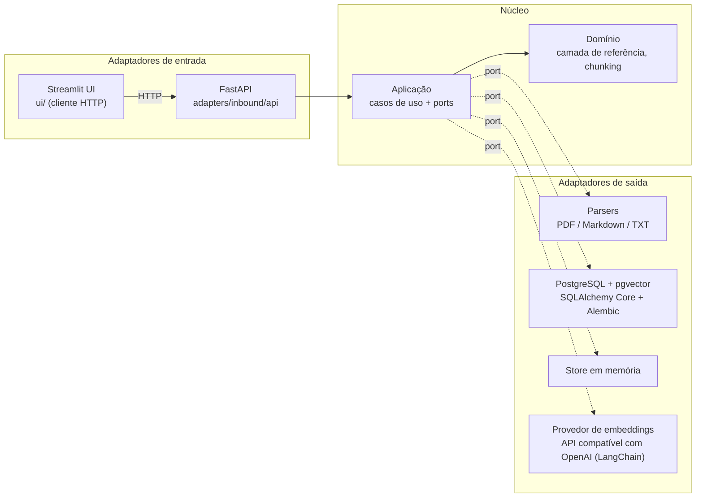
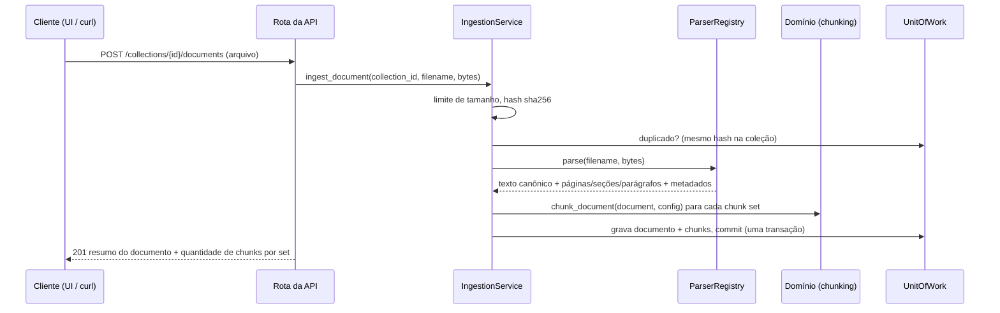
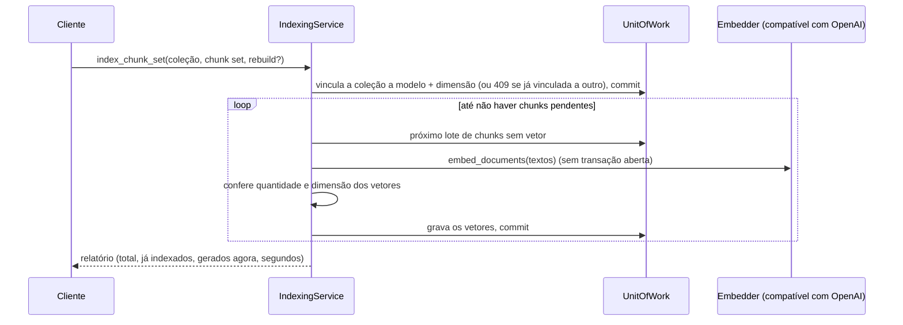
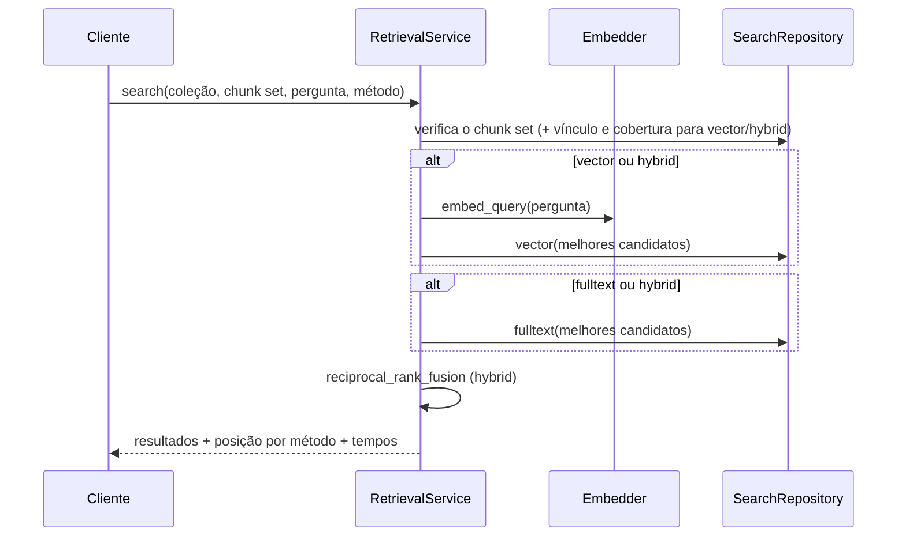

# Arquitetura

O RAG Benchmark Lab usa **arquitetura hexagonal** (ports and adapters). As regras de negócio ficam em um núcleo puro. Frameworks, bancos de dados e provedores de modelos se conectam por fora. Assim, estratégias de recuperação, provedores de LLM e armazenamento podem ser trocados e comparados sem tocar nas regras que estão sendo medidas.

> Outros idiomas: [English](../en/architecture.md)

## As camadas de relance



| Camada | Pacote | Propósito | Pode importar |
|--------|--------|-----------|---------------|
| Domínio | `rag_lab.domain` | Conceitos de negócio e algoritmos puros (spans, documentos, chunking) | Apenas a biblioteca padrão |
| Aplicação | `rag_lab.application` | Casos de uso e os ports (interfaces) de que precisam | Domínio |
| Adaptadores | `rag_lab.adapters` | Implementam ports (saída) ou chamam casos de uso (entrada) | Aplicação, domínio, frameworks |
| Composition root | `rag_lab.bootstrap` | Decide qual adaptador implementa cada port | Tudo |
| UI | `rag_lab.ui` | Páginas Streamlit; fala com o sistema **somente pela API HTTP** | `config` e seus próprios módulos |

**A regra de dependência:** as setas apontam apenas para dentro. O domínio nunca importa FastAPI, SQLAlchemy, pypdf ou LangChain. O verificador de tipos (`mypy --strict`) e a suíte de testes rodam em todo commit, então uma violação aparece imediatamente.

## Fluxos de dados

### Ingestão (implementada)



### Indexação (implementada)



Cada lote recebe seu próprio commit, então uma falha do provedor no meio do caminho não perde nada: a próxima execução gera só o que ainda está pendente.

### Recuperação (implementada)



### Perguntas e respostas (planejado, fases 4–5)

`Pergunta → estratégia de recuperação (vetorial / full-text / híbrida) → filtros → reranking → contexto → LLM → resposta com citações`, ou abstenção quando a evidência é insuficiente.

## A camada de referência: por que o chunking pode variar livremente

Esta é a decisão de design mais importante do projeto. Veja o [ADR-002](decisions.md#adr-002-camada-de-referência-independente-do-chunking).

- Cada documento é processado **uma única vez** em um **texto canônico**.
- Páginas, seções e parágrafos são armazenados como **spans** (offsets de caracteres `[início, fim)`) sobre esse texto.
- Um **chunk** é apenas um span com metadados derivados (números de página, caminho de títulos).
- Os rótulos do golden dataset (fase 6) também serão spans sobre o mesmo texto.

```text
texto canônico:  |# Install\nRun it.\n\n## Docker\ndocker compose up\n|
seções:          [0 ─────────── 19)[19 ───────────────────────── 47)
fixed-20-0:      [0 ──── 20)[20 ──── 40)[40 ─ 47)
structure-800-0: [0 ─────── 17)  [19 ────────────────────── 46)
rótulo golden:                         [29 ──────────── 46)
```

A relevância é medida pela **sobreposição entre spans**, e não pela correspondência de ids de chunk. Um rótulo escrito uma vez continua válido para qualquer configuração de chunking, e é isso que torna possível uma matriz de benchmark chunking × recuperação.

## Isolamento

A **coleção** é a fronteira de isolamento. Todo método de repositório que retorna documentos ou chunks recebe um `collection_id`, então a própria assinatura do port garante o escopo. Os testes de contrato em `tests/contracts/test_isolation.py` rodam contra os adaptadores em memória e PostgreSQL. Eles provam que documentos idênticos em duas coleções ficam separados e que o id de um documento de outra coleção retorna *não encontrado*.

## Próximos passos

| Quero entender… | Leia |
|-----------------|------|
| Spans, documentos, algoritmos de chunking | [domain.md](domain.md) |
| Casos de uso, ports, transações | [application.md](application.md) |
| Parsers, PostgreSQL, API, UI | [adapters.md](adapters.md) |
| Configurações do `.env` e provedores | [configuration.md](configuration.md) |
| Estratégia de testes e como rodá-los | [testing.md](testing.md) |
| Por que cada tecnologia foi escolhida | [decisions.md](decisions.md) |
